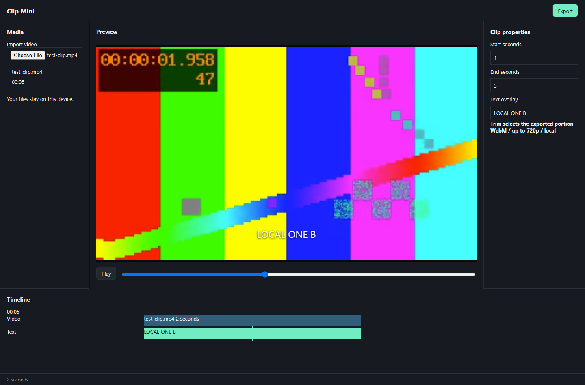
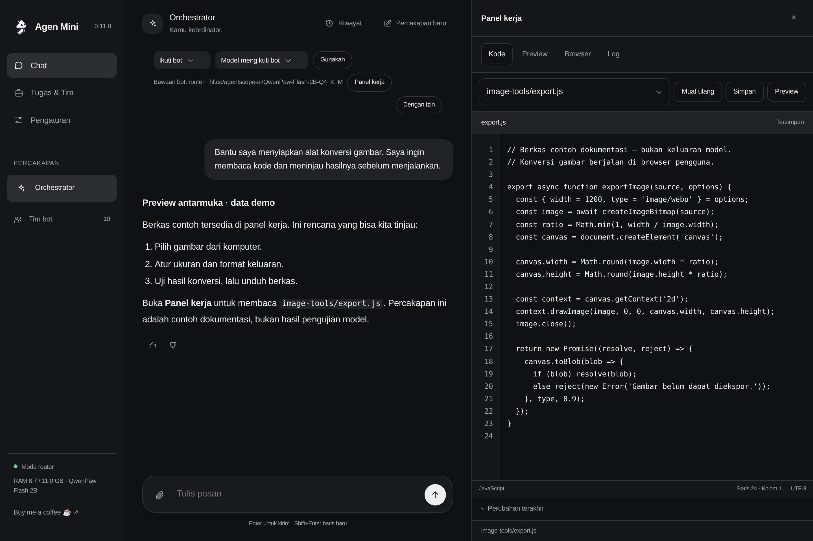
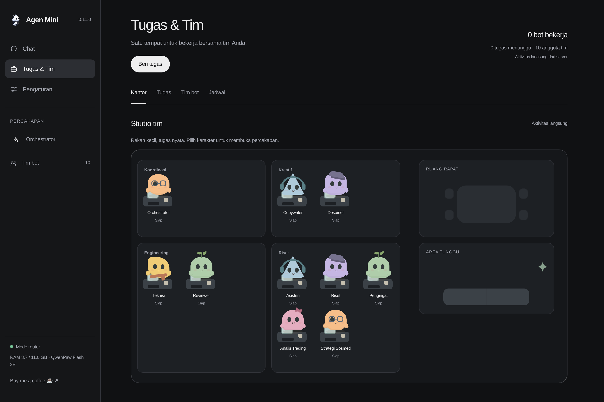
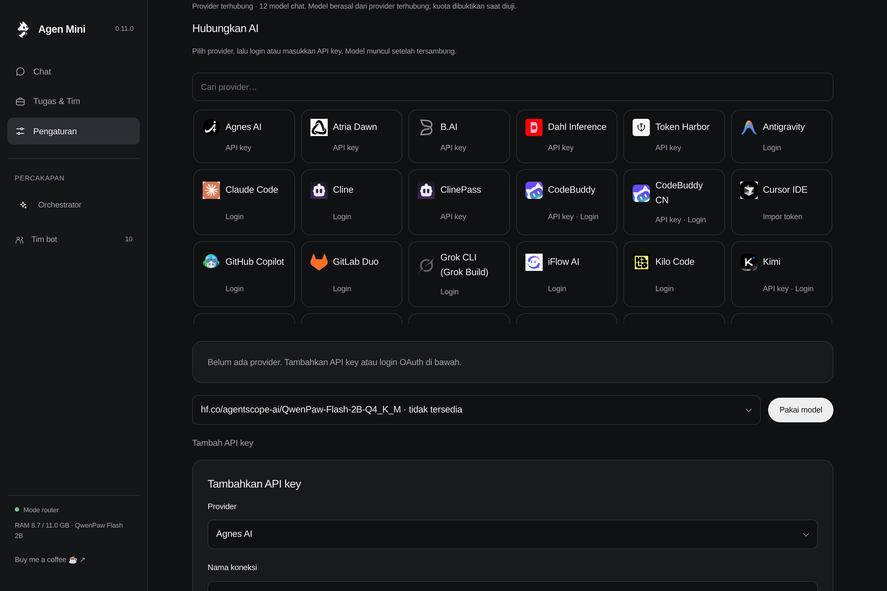
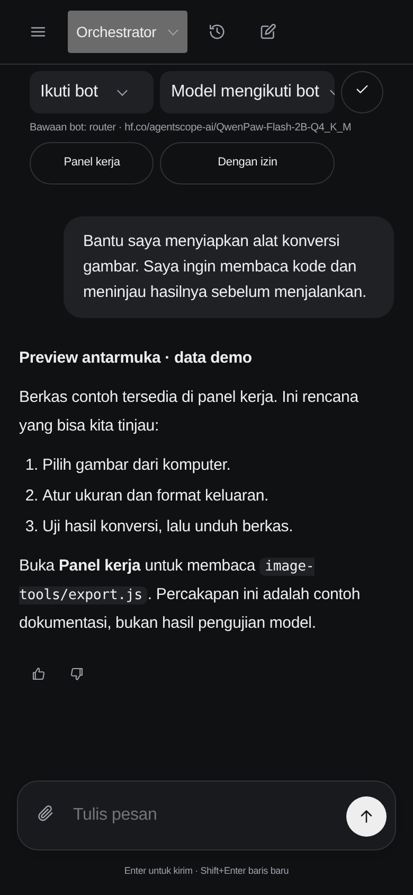
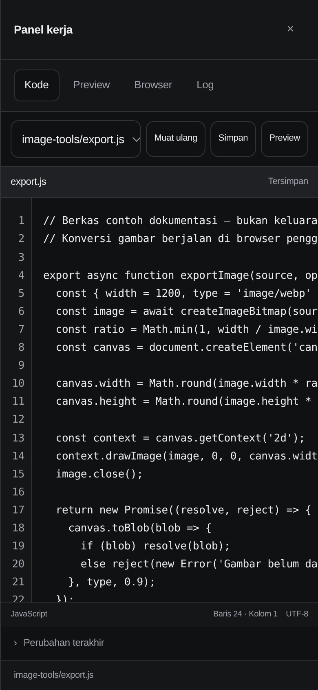

<p align="center">
  
</p>
<h1 align="center">Agen Mini</h1>
<p align="center"><strong>Your models. Your workspace. Work you can inspect.</strong></p>
<p align="center">A lightweight AI workspace for local models and online providers.<br>Chat, code, delegate, and inspect the files and tool results behind an answer.</p>
<p align="center">
  <a href="https://github.com/Zwart04/agenmini/releases/latest">Download</a> ·
  <a href="docs/INSTALL.md">Getting started</a> ·
  <a href="docs/BENCHMARKS.md">Small-model benchmark</a> ·
  <a href="README.id.md">Bahasa Indonesia</a>
</p>
<p align="center">
  
  <a href="LICENSE"></a>
</p>

> **Public preview.** Packages and checksums are on GitHub Releases. Provider quotas and local-model availability still vary, so expect rough edges.

## Small models. A working video editor.

**Clip Mini** is our documented local-model benchmark: a browser video editor with a CapCut-inspired workflow. It imports a clip, plays and seeks, trims a range, adds text, and exports a downloadable WebM with audio.

[](docs/BENCHMARKS.md)

| What was tested | Recorded result |
| --- | --- |
| Local model contributors | Qwen3.5 **0.8B** and DeepSeek Coder **1.3B** |
| Browser workflow | Import → playback / seek → trim → text → export → download |
| Export verification | Exported video decoded; motion, audio, text and trim checked |
| Example trim | 5-second input → seconds 1–3 → **1.956-second** output with text |
| Recovery checks | Invalid trim, keyboard input, cancellation, and export after cancellation |

The harness breaks work into small parts, checks behavior, and requests repairs. Runtime code came from local-model outputs; the evaluator supplied contracts, tests, and assembly. **This was a combined result across multiple attempts, not a one-shot 1B generation.** The editor handles one clip; it does not implement CapCut's full feature set. Results were recorded on October 23, 2026.

[Read the benchmark, measurements, and provenance →](docs/BENCHMARKS.md)

## Why Agen Mini

| Capability | What you get |
| --- | --- |
| **Bring your own model** | Local endpoints, direct APIs, and an integrated OAuth/API connection gateway. Switch providers in Settings and models per conversation or bot. |
| **Inspectable work** | Code panel, file edits, tool logs, approvals, and project previews alongside chat. |
| **One workflow across channels** | Web and Telegram share the built-in agent loop, including context compaction and tool checks. |
| **A small team when needed** | An Orchestrator and optional specialist bots with separate model choices. |
| **Learning you can edit** | Reviewable procedures, editable skills and memory; external MCP tools are optional. This does not retrain model weights. |
| **A lean interface** | System fonts, native browser rendering, no Electron shell or large editor framework. Model weights are downloaded separately. |

## A workspace you can follow

[](docs/screenshots/workbench-desktop.png)

Read code, review changes, and inspect tool activity without leaving the conversation. File saves check for conflicts with the agent's edits. Preview runs in an isolated frame; backend projects and sites that refuse embedding need their own server or tab.

[Light theme](docs/screenshots/workbench-light.png) · [Editor close-up](docs/screenshots/editor-detail.png) · [Desktop and mobile gallery](docs/screenshots/README.md)

<details>
<summary>Team workspace, providers, and mobile</summary>

[](docs/screenshots/workspace-desktop.png)

[](docs/screenshots/providers-desktop.png)

<p>
  <a href="docs/screenshots/chat-mobile.png"></a>
  <a href="docs/screenshots/workbench-mobile.png"></a>
</p>

[Interface tour: MP4, 1920 × 1280](https://raw.githubusercontent.com/Zwart04/agenmini/main/docs/screenshots/preview.mp4) · [Animated GIF](docs/screenshots/preview.gif)

These workspace images use documentation demo data. The model-generated benchmark image and measurements are documented separately above.

</details>

## Download and install

**[Download the package for your platform →](https://github.com/Zwart04/agenmini/releases/latest)**

| Platform | Available package | Includes |
| --- | --- | --- |
| Windows 10 / 11 x64 | Installer `.exe` or portable `.zip` | App and `agenmini.cmd` CLI |
| Debian / Ubuntu / Mint | `.deb`, amd64 / arm64 | App and `agenmini` CLI |
| Fedora | `.rpm`, x86_64 / aarch64 | App and CLI |
| Arch / EndeavourOS / Manjaro | `.pkg.tar.zst`, x86_64 | App and CLI |
| Other GNU/Linux | Portable `.tar.gz`, amd64 / arm64, glibc 2.35+ | Private Python and gateway |
| macOS and other platforms | Source ZIP, manual setup | No native installer yet |

Verify the matching SHA256 before installing. Linux packages bundle private Python and the Go connection gateway; Node.js, Git and xdg-utils are system dependencies. Desktop opens in your existing browser. Packages do not contain model weights or provider accounts.

**[English install, update, and uninstall guide](docs/INSTALL.md)** · [All release files and checksums](https://github.com/Zwart04/agenmini/releases/latest)

1. Open Agen Mini and choose **Local AI** or **Online AI** first. Optional harness, bot, password and swap settings are under Advanced.
2. Connect a running local model, choose an online provider through the gateway, or enter a direct API endpoint. Setup completes only after a real response check succeeds. Later, change the source in **Settings → AI connections & model** (**Pengaturan → Koneksi AI & model**).
3. Choose a model and give the Orchestrator a task. Review tool results and files before accepting the output.
4. Connect Telegram if needed. `/model` changes the model; the built-in harness is shared with the web app.

On Linux, `agenmini provider online` and `agenmini model MODEL-ID` change the selected source and model. Windows uses `agenmini.cmd`. Configure the endpoint and API key in Settings first.

## How the harness works

**Load relevant context → choose an action → validate tools and permissions → execute → record results → verify → answer.**

The built-in loop adapts selected control contracts from [DeepSeek Harness](https://github.com/deepseek-ai/deepseek-harness), with attribution retained. Long chats use context compaction; the original messages remain stored. Interrupted mutations are not replayed automatically. Web, local/API backends, and Telegram use the same built-in core.

Skills, memory, and operating instructions can be inspected and edited. Self-improvement stores reviewed procedures with evidence; it does not make every small model reliable or equivalent to a larger model. Original external harness runtimes are separate, optional installs with their own permissions and credentials.

[Harness architecture](docs/DEEPSEEK-CORE.md) · [External runtimes](docs/HARNESSES.md) · [Context compaction](docs/CONTEXT-COMPACTION.md)

## Verification and development

[Project tests](https://github.com/Zwart04/agenmini/actions/workflows/test.yml) · [Windows installation tests](https://github.com/Zwart04/agenmini/actions/workflows/windows.yml) · [Linux package tests](https://github.com/Zwart04/agenmini/actions/workflows/linux.yml) · [Runtime installation matrix](https://github.com/Zwart04/agenmini/actions/workflows/harnesses.yml) · [Secret scan](https://github.com/Zwart04/agenmini/actions/workflows/secrets.yml)

CI checks the core, package installation, login, CLI settings, update/data preservation, and removal. Those checks do not prove every external provider account works or that every generated application is correct. Real-model evaluations and UI demo captures are reported separately.

```sh
python -m pytest tests -q
# Optional real local-model evaluation; requires your own llama.cpp and GGUF:
python scripts/evaluate_apps.py --server-exe /path/llama-server --gguf /path/model.gguf
```

[Validation notes](VALIDATION.md) · [Project map](docs/PROJECT-MAP.md) · [Security audit](docs/SECURITY-AUDIT.md) · [Report an issue](https://github.com/Zwart04/agenmini/issues)

## Support development

If Agen Mini helps your work, you can buy its independent developer a coffee. Contributions support maintenance and testing; the app works without a donation. The button opens the developer's **Tako** page.

<a href="https://tako.id/Zwart04/gift"></a>

## License

Original Agen Mini work from 0.11.0 is **GPL-3.0-or-later**, copyright © 2026 Zwart04. Distributed without warranty. [License](LICENSE) · [Third-party notices](THIRD_PARTY_NOTICES.md). Dependencies and provider trademarks retain their own terms. Corresponding application source and build scripts accompany each binary release.
