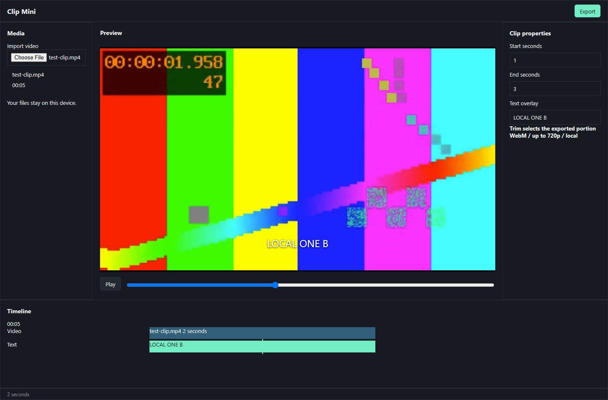

# Small-model benchmark: Clip Mini

**A real browser application from local-model outputs, checked beyond syntax.**

Clip Mini implements a familiar video-editing workflow: import a clip, preview
it, choose a trim range, add text, and export a downloadable video with audio.
The task was inspired by web editors such as CapCut; this is a **single-clip
editor**, not a reproduction of the complete CapCut product.

[](screenshots/model-editor-v208.png)

*Original V208 browser screenshot, October 23, 2026. The color bars are the
moving test video, not a placeholder for a missing preview. This image is
separate from the documentation demo screenshots of Agen Mini itself.*

## What makes the result useful

The harness decomposes a difficult application into smaller model tasks,
retains accepted source with provenance, runs checks, and asks the model to
repair failures. An output is not accepted just because it parses or fits in a
ZIP. Controls must connect to the implementation, and exported media must work.

| Stage | Recorded check |
| --- | --- |
| Import | Load an actual MP4 into the editor |
| Preview | Play/pause, scrub, and click the timeline |
| Edit | Trim seconds 1–3 of a 5-second input; add a text overlay |
| Export | Record and download WebM; decode the downloaded file |
| Media | Check duration, source motion, audio, and text encoded into frames |
| Recovery | Reject an invalid trim; cancel twice; export successfully afterward |
| Layout | No document overflow at 1440px desktop and 390px mobile |

## Models and code provenance

- **Qwen3.5 0.8B, Q8_0:** 145 accepted source parts in the V208 candidate.
- **DeepSeek Coder 1.3B, Q5_K_M:** export orchestration and controls.
- Runtime implementations came from local-model outputs. The evaluator provided
  contracts, tests, assembly, and documentation, rather than replacing runtime
  code with a prewritten application.
- The final candidate combined accepted parts from **multiple attempts and two
  models**. It does not establish a one-shot result from a single 1B model.
- This experiment used inference and harness improvements, not weight training
  or an undisclosed online model.

## Measured exports

Recorded October 23, 2026. The test source was five seconds long; the requested
trim was seconds 1–3. FFprobe inspected the files and FFmpeg decoded them.

| V208 output | With text | Without text |
| --- | --- | --- |
| Duration | 1.956 s | 1.965 s |
| Frame size / video codec | 320 × 180 / VP9 | 320 × 180 / VP9 |
| Audio RMS, 0–1 scale | 0.1246 | 0.1246 |
| File size | 243,901 bytes | 247,872 bytes |

Three sampled times showed source motion. The title region contained 296–301
white pixels with text and zero without it. The later V215 candidate repeated
the browser checks and produced 1.973 / 1.976-second exports. Frame comparisons
also checked that the trim started at second 1, not merely at the input's start.

These results describe this small test clip. They do not measure arbitrary
long videos, all codecs, 720p performance, or production workloads.

## Scope and limitations

Supported in the recorded candidate: one input clip, playback/seek, trim, text,
audio, real-time WebM export, cancellation, and repeat export.

Not demonstrated: a multi-clip composition engine, transitions/effects,
automatic captions, collaboration, or the complete feature set of a commercial
editor. Smaller models still fail tasks; the development record preserves those
failures as failures. A stronger harness improves the work process, not the
model's parameter count or its guaranteed ability on every task.

The built-in harness is shared by local models, APIs, and the connection
gateway, on web and Telegram. This benchmark does not verify every online
provider or actual Telegram delivery.

## Evidence and reproducibility

The public evidence includes the original screenshot above, the measurements,
and the [full development record](LOCAL-APPS-EVAL.md), including failed rounds.
The original private run directories and generated application bundle are not
present in this checkout. Therefore this page reports the **recorded run**;
updating this page or passing project tests is not a new inference run or an
independent replay of that editor.

For a fresh run, provide your own GGUF and compatible llama.cpp server:

```sh
python scripts/evaluate_apps.py --help
python scripts/evaluate_apps.py \
  --server-exe /path/llama-server \
  --gguf /path/model.gguf \
  --case video \
  --output-dir /path/to/new-private-run
```

Use a new private output directory and retain the actual generation report,
model hashes, source, browser results, and downloaded exports. Browser and media
verification are required separately; a helper test alone is insufficient.
Check the evaluator's current options with `--help` before a long run.

[Back to the README](../README.md) · [Harness adaptation](DEEPSEEK-CORE.md)
